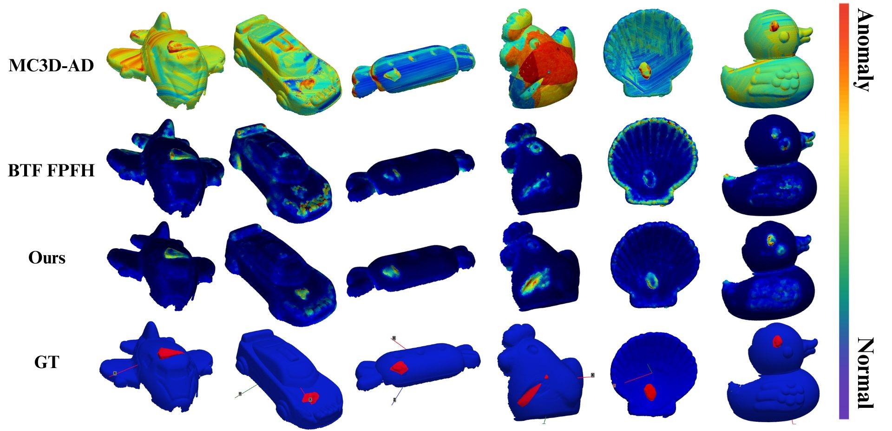

# SPARE: A Fast and Accurate Approach Based on Handcrafted Features and Lightweight Fusion for 3D Anomaly Detection

Official implementation of the SPARE paper.



*Anomaly maps on Real3D-AD: MC3D-AD, BTF (FPFH) and SPARE (Ours), with the ground truth (GT).*

## 1. Get the code

```bash
git clone --recursive https://github.com/techo2game/SPARE.git
cd SPARE
```

## 2. Download the data and the pretrained models

**Real3D-AD dataset** (3.5 GB, from the [official Real3D-AD repository](https://github.com/M-3LAB/Real3D-AD)): download `real3d-ad-pcd.zip` from [Google Drive](https://drive.google.com/file/d/1oM4qjhlIMsQc_wiFIFIVBvuuR8nyk2k0/view) or [Baidu Netdisk](https://pan.baidu.com/s/1orQY3DjR6Z0wazMNPysShQ) (code: `vrmi`).

**Pretrained models** (36 MB): download `spare_pretrained.tar.gz` from [Google Drive](https://drive.google.com/file/d/1FfYRcfizwtP-KTVe84uC_OTFqKvEwx1D/view) or [Weiyun](https://share.weiyun.com/BTWP9eVi).

Extract both inside the `SPARE` folder:

```bash
unzip real3d-ad-pcd.zip && mkdir -p data && mv Real3D-AD-PCD data/Real3D
tar -xzf spare_pretrained.tar.gz
```

You should get:

```
SPARE/
├── data/Real3D/            # Real3D-AD: airplane/, candybar/, ... each with train/, test/, gt/
├── pretrain/parenet.tar    # PARENet registration weights
├── logs/<category>/...     # SPARE models, one per category
├── spatial_memory_banks/   # memory banks used for the paper's results
└── reg_output/real3d-ad/   # reference sample of each category
```

If Real3D-AD is already stored elsewhere, you can keep it there and add `REAL3D_AD=/path/to/Real3D-AD` in front of the `./run.sh` commands below.

## 3. Evaluate the pretrained models

Requirements: Linux, an NVIDIA GPU, [Docker](https://docs.docker.com/engine/install/) and the [NVIDIA Container Toolkit](https://docs.nvidia.com/datacenter/cloud-native/container-toolkit/install-guide.html).

```bash
./run.sh scripts/evaluate.sh
```

The first run builds the Docker environment (about 10 minutes, once). The script then evaluates every category that has a model in `logs/`, with the memory banks from the pretrained archive. To evaluate some categories only: `CATEGORIES="airplane car" ./run.sh scripts/evaluate.sh`.

`./run.sh` alone opens a shell in the environment. Without Docker, see [docs/install_conda.md](docs/install_conda.md).

## 4. Retrain SPARE

To run the whole training pipeline with one command:

```bash
./run.sh scripts/train.sh
```

It runs steps 4.2 to 4.6 below for every category (or only `CATEGORIES="airplane car"`) and keeps the PARENet weights from step 2.

### Step by step

Open a shell in the environment with `./run.sh`, then run the steps in order. Each command processes all categories; add `--category airplane` to process a single one.

**4.1 Train PARENet (optional).** The pretrained registration weights from step 2 can be reused. To retrain them on Real3D-AD:

```bash
python parenet_real3dad/trainval.py
cp parenet_real3dad/output/snapshots/<run>/epoch-<N>.pth.tar pretrain/parenet.tar
```

Checkpoints are saved after every epoch (60 epochs); the released weights are `epoch-8.pth.tar`.

**4.2 Register the training samples** to a reference sample (9-DOF Adam/Chamfer alignment). Output: `reg_output/real3d-ad/<category>/train/`.

```bash
python compute_train_variability.py configs/real3d-ad/base.yaml --use_adam_9dof --save_transforms --first_sample_only
```

**4.3 Build the spatial memory banks** (FPFH features and patch geometry of the registered samples). Output: `spatial_memory_banks/`.

```bash
python build_spatial_fpfh_memory_bank.py configs/real3d-ad/base.yaml
```

**4.4 Generate the synthetic anomalies** used for training (settings in `configs/synthetic_anomalies_seed_based.yaml`). Output: `synthetic_data/real3d-ad/`.

```bash
python generate_synthetic_batch.py configs/real3d-ad/base.yaml
```

**4.5 Train the fusion model** (settings in `configs/training/sigmoid_fusion.yaml`). Output: `logs/<category>/<timestamp>/`.

```bash
python train_fpfh_chamfer_batch.py \
    --training_config configs/training/sigmoid_fusion.yaml \
    --dataset_config configs/real3d-ad/base.yaml
```

**4.6 Evaluate** the most recent model of each category in `logs/`:

```bash
python test_fusion_model.py \
    --dataset_config configs/real3d-ad/base.yaml \
    --testing_config configs/testing/sigmoid_fusion.yaml
```

## Citation

If you find this work useful, please cite:

```bibtex
@inproceedings{lhoste2026spare,
  title     = {{SPARE}: A Fast and Accurate Approach Based on Handcrafted Features and Lightweight Fusion for {3D} Anomaly Detection},
  author    = {Lhoste, Remi and Delhay, Damien and Baou, Zakaria and Vacavant, Antoine},
  booktitle = {International Conference on Pattern Recognition (ICPR)},
  year      = {2026}
}
```

## Acknowledgements

We thank the authors of [PARENet](https://github.com/yaorz97/PARENet) and [cudaKDTree](https://github.com/ingowald/cudaKDTree) for releasing their code, on which this work builds.

## License

This project is licensed under the [GNU General Public License v3.0](LICENSE). PARENet and cudaKDTree are included as git submodules under their own licenses (see [THIRD_PARTY.md](THIRD_PARTY.md)).
